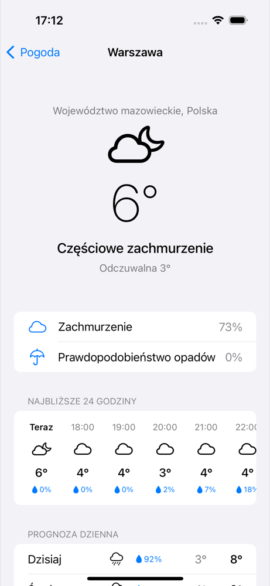
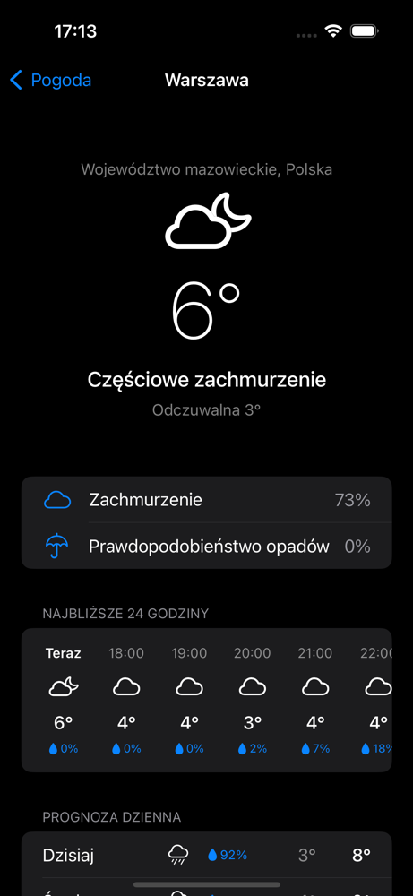
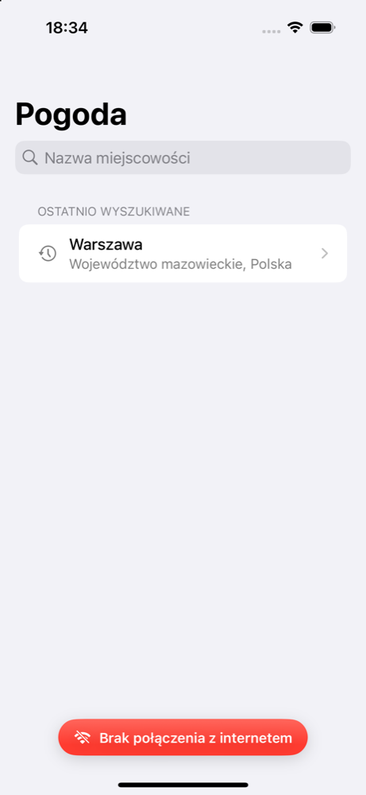
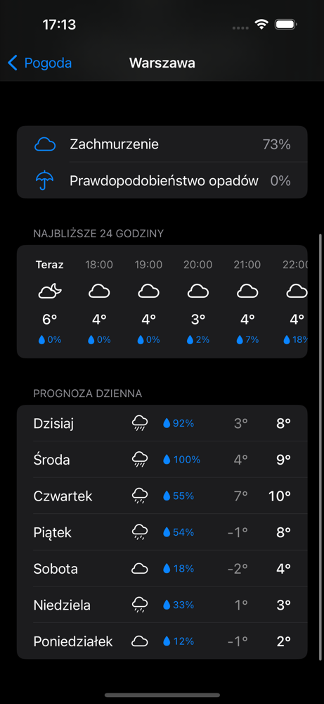
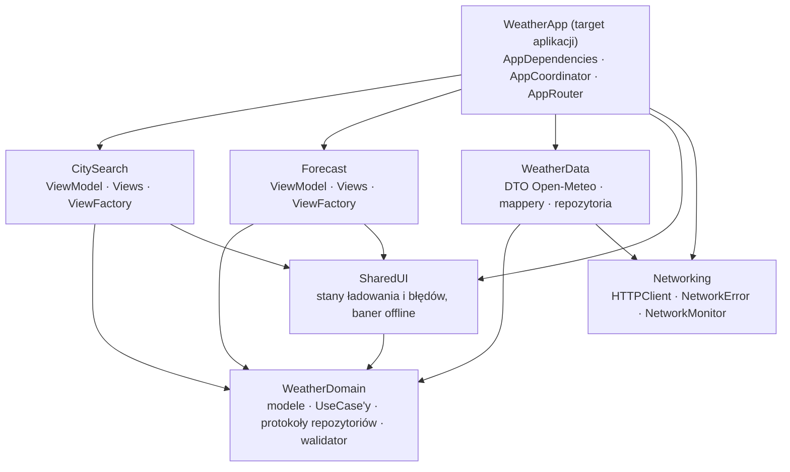

# WeatherApp

Aplikacja iOS do sprawdzania prognozy pogody, przygotowana jako zadanie rekrutacyjne. Pozwala wyszukać
miejscowość, pamięta historię wyszukiwania między uruchomieniami i pokazuje szczegółową prognozę:
aktualne warunki, najbliższe 24 godziny i 7 kolejnych dni.

Mimo niewielkiego zakresu projekt jest zbudowany jak aplikacja produkcyjna: podzielony na moduły SPM,
z warstwami MVVM-C, testami jednostkowymi i obsługą wszystkich stanów aplikacji.

| Wyszukiwanie | Prognoza | Prognoza (Dark Mode) | Historia (Dark Mode) |
|:---:|:---:|:---:|:---:|
|  |  |  |  |

| Walidacja | Brak wyników | Brak połączenia | Prognoza dzienna |
|:---:|:---:|:---:|:---:|
|  |  |  |  |

## Uruchomienie

**Wymagania:** Xcode 26 lub 27, iOS 17 lub nowszy.

1. Sklonuj repozytorium i otwórz `WeatherApp.xcodeproj`.
2. Wybierz schemat `WeatherApp` i dowolny symulator lub urządzenie z iOS 17+.
3. Uruchom (⌘R).

Projekt nie ma zewnętrznych zależności ani kluczy API. Dane pochodzą z [Open-Meteo](https://open-meteo.com),
które udostępnia wyszukiwanie miejscowości i prognozę bez rejestracji.

## Funkcje

- **Wyszukiwanie miejscowości** z walidacją w trakcie pisania:
  - przyjmuje litery dowolnego alfabetu (także polskie znaki), spacje i myślniki, np. „Bielsko-Biała”, „Nowy Sącz”;
  - odrzuca cyfry i znaki specjalne, osobnym komunikatem dla każdego przypadku;
  - zapytanie trafia do API po 400 ms przerwy w pisaniu, a poprzednie zapytanie jest anulowane.
- **Lista wyników** z regionem i krajem, żeby odróżnić miejscowości o tej samej nazwie.
- **Historia wyszukiwania**: ostatnie 10 otwartych miejscowości, bez duplikatów, najnowsze na górze. Wpis można usunąć gestem przesunięcia. Historia przetrwa ponowne uruchomienie aplikacji.
- **Szczegóły prognozy**:
  - aktualna temperatura, temperatura odczuwalna i opis warunków;
  - zachmurzenie i prawdopodobieństwo opadów;
  - prognoza na najbliższe 24 godziny i na 7 dni;
  - odświeżanie przeciągnięciem w dół.
- **Baner braku połączenia** widoczny na każdym ekranie.
- **Dark Mode, Dynamic Type i VoiceOver**: wyłącznie natywne komponenty i kolory semantyczne. Przy dużych rozmiarach tekstu wiersze przechodzą w układ pionowy.
- **Język polski i angielski** (String Catalogs, w tym poprawne formy liczby mnogiej). Język wyników z API też podąża za językiem aplikacji.
- **Jednostki i czas**: temperatury w jednostce z ustawień regionalnych użytkownika (°C lub °F), godziny w strefie czasowej wybranego miasta.

## Architektura

Aplikacja stosuje MVVM-C z warstwą domenową (UseCase'y) i danych (Repository + Mapper).
Kod jest podzielony na moduły lokalnego pakietu SPM `Packages/WeatherAppKit`, a target aplikacji służy
tylko do złożenia zależności i nawigacji.



Najważniejsza zasada: **funkcje (`CitySearch`, `Forecast`) zależą tylko od `WeatherDomain`**. Nie wiedzą
nic o Open-Meteo, sieci ani UserDefaults. Implementacje repozytoriów z `WeatherData` są wstrzykiwane
w jednym miejscu, w `AppDependencies`. Zmiana dostawcy pogody oznacza nowy moduł danych, a funkcje się nie zmieniają.

### Warstwy i odpowiedzialności

| Element | Odpowiada za | Nigdy nie |
|---|---|---|
| `AppCoordinator` + `AppRouter` | nawigację: zamienia akcje z ViewModeli na przejścia w typowanej ścieżce `NavigationStack` | nie zawiera logiki biznesowej |
| `ViewFactory` | tworzenie ekranu: ViewModel + UseCase'y z wstrzykniętymi zależnościami | nie wykonuje pracy przy tworzeniu |
| `ContainerView` | obserwuje ViewModel, przekazuje stan i akcje do widoku | nie podejmuje decyzji o wyglądzie |
| `View` | rysuje stan i wywołuje akcje przez domknięcia | nie trzyma referencji do ViewModelu ani logiki |
| `ViewModel` (`@Observable`) | cały stan ekranu jako enum, wywołuje UseCase'y, emituje akcje nawigacyjne | nie nawiguje sam i nie sięga do repozytorium |
| `UseCase` | jedna operacja biznesowa i jej reguły, np. limit i deduplikacja historii | nie wywołuje innych UseCase'ów |
| `Repository` + `Mapper` | dostęp do danych, mapowanie DTO na modele domenowe | nie zawiera logiki biznesowej |

Zależności są wstrzykiwane przez inicjalizatory i opisane protokołami `Has…` (np. `HasCityRepository`),
składanymi przez `&`. Każdy typ deklaruje dokładnie to, czego potrzebuje, a test dostarcza tylko te atrapy.

### Struktura projektu

```
WeatherApp/                   target aplikacji: złożenie zależności i nawigacja
├─ App/                       punkt wejścia, AppDependencies (composition root)
├─ Navigation/                AppCoordinator, AppRouter, AppCoordinatorView
├─ Connectivity/              ConnectivityViewModel (baner offline)
└─ Resources/                 InfoPlist.xcstrings
WeatherAppTests/              testy Coordinatora i łączności
WeatherAppUITests/            testy UI niezależne od sieci
Packages/WeatherAppKit/
├─ Sources/
│  ├─ Networking/             HTTPClient, Endpoint, NetworkError, NetworkMonitor
│  ├─ WeatherDomain/          Models/, UseCases/, Repositories/ (protokoły), Validation/
│  ├─ WeatherData/            DTO/, Mappers/, Repositories/, OpenMeteo/
│  ├─ SharedUI/               ErrorStateView, LoadingStateView, OfflineBanner
│  ├─ CitySearch/             ViewModel, Views/, ViewFactory, Resources/ (xcstrings)
│  ├─ Forecast/               ViewModel, Views/, ViewFactory, Resources/ (xcstrings)
│  └─ NetworkingTestSupport/  atrapa URLProtocol współdzielona przez testy
└─ Tests/                     testy dla każdego modułu
```

## Obsługa stanów

| Stan | Wyszukiwanie | Prognoza |
|---|---|---|
| Ładowanie | `ProgressView` „Wyszukiwanie…” po upływie opóźnienia | `ProgressView` „Wczytywanie prognozy…” |
| Puste pole | historia albo zachęta do wyszukania | — |
| Za krótkie zapytanie | podpowiedź „Wpisz co najmniej 2 litery” (API nie zwraca wyników dla 1 znaku) | — |
| Niepoprawne znaki | komunikat nad listą, bez zapytania do API | — |
| Pusty wynik | systemowe `ContentUnavailableView.search` | — |
| Brak internetu | `ContentUnavailableView` z przyciskiem „Spróbuj ponownie” i baner na dole ekranu | jak w wyszukiwaniu |
| Błąd API | komunikat z pola `reason` odpowiedzi Open-Meteo, z ponowieniem | jak w wyszukiwaniu |
| Nieudane odświeżenie | — | prognoza zostaje na ekranie, nad nią informacja o błędzie |

Brak połączenia jest rozpoznawany z błędu `URLError` przy samym zapytaniu (`notConnectedToInternet`,
`networkConnectionLost`, timeout, nieosiągalny host). `NWPathMonitor` steruje tylko banerem, bo jego
odczyty potrafią się spóźniać względem faktycznego stanu sieci. Anulowane zapytania (np. przy dalszym
pisaniu) nie pokazują błędu.

## Decyzje techniczne i kompromisy

- **SwiftUI i `@Observable`**: natywne od iOS 17, bez Combine. Kontener trzyma ViewModel w `@State`, co przy `@Observable` zastępuje `@StateObject`.
- **Swift 6 ze ścisłą kontrolą współbieżności**: typy przekazywane między wątkami są `Sendable`, ViewModele działają na `@MainActor`, a błędy są typowane (`throws(DomainError)`).
- **Moduły SPM zamiast folderów**: granice między warstwami pilnuje kompilator, a moduły można budować i testować osobno. Kosztem jest trochę więcej konfiguracji (`Package.swift`, publiczne API).
- **UseCase także tam, gdzie tylko przekazuje wywołanie** (np. `GetForecastUseCase`): granica ViewModel–dane jest wszędzie taka sama, a reguły biznesowe (deduplikacja i limit historii, minimalna długość zapytania) mają swoje miejsce i testy.
- **Historia w UserDefaults zamiast SwiftData**: to krótka lista małych rekordów. SwiftData dodałoby kontener modeli i `@Query` w widokach, co łamie podział na warstwy, bez żadnej korzyści. Zapis idzie przez osobne DTO z wersjonowanym kluczem (`searchHistory.v1`), więc format można później zmienić.
- **Open-Meteo**: brak klucza API i wyszukiwanie miejscowości w pakiecie. Prawdopodobieństwo opadów „teraz” jest brane z danych godzinowych dla bieżącej godziny, bo API podaje je tylko godzinowo.
- **Walidacja w dwóch krokach**: najpierw normalizacja (sklejanie rozłożonych polskich znaków, przycinanie spacji i myślnika pisanego na końcu, np. „Bielsko-”), potem sprawdzenie dozwolonych znaków. Dzięki temu użytkownik nie dostaje błędu w trakcie zwykłego pisania.
- **Ikony pogody**: SF Symbols w wersji konturowej, bo wypełnione ikony chmur w trybie wielokolorowym są białe i znikają na jasnym tle.
- **Zero zależności zewnętrznych**: sieć to `URLSession` z async/await, a atrapy w testach są pisane ręcznie.

## Testy

**63 testy w pakiecie** (Swift Testing) i **4 testy w aplikacji**, plus 2 testy UI:

| Moduł | Co testujemy |
|---|---|
| `Networking` | dekodowanie, budowanie URL z polskimi znakami, mapowanie błędów `URLError` i kodów HTTP |
| `WeatherDomain` | walidator (polskie znaki, cyfry, znaki specjalne, normalizacja), reguły historii, wyszukiwanie |
| `WeatherData` | mappery na danych w kształcie prawdziwych odpowiedzi Open-Meteo, kody pogody WMO, repozytoria przez atrapę `URLProtocol`, zapis historii |
| `CitySearch` | przejścia stanów ViewModelu, opóźnienie i anulowanie zapytań, walidacja, historia, akcje nawigacyjne |
| `Forecast` | ładowanie, ponowienie, odświeżanie z zachowaniem danych, formatowanie temperatur (bez „-0°”, °F dla `en_US`) |
| aplikacja | Coordinator i Router, baner łączności, testy UI startu i walidacji |

Żaden test nie korzysta z prawdziwej sieci.

**W Xcode:**
- testy aplikacji: schemat `WeatherApp`, ⌘U;
- testy pakietu: otwórz `Packages/WeatherAppKit/Package.swift` i uruchom ⌘U na schemacie `WeatherAppKit-Package`.

**Z terminala** (nazwę symulatora dopasuj do dostępnych w `xcrun simctl list devices`):

```bash
# testy pakietu
cd Packages/WeatherAppKit
xcodebuild test -scheme WeatherAppKit-Package -destination 'platform=iOS Simulator,name=iPhone 16'

# testy aplikacji
cd ../..
xcodebuild test -project WeatherApp.xcodeproj -scheme WeatherApp -destination 'platform=iOS Simulator,name=iPhone 16'
```

## Znane ograniczenia

- Brak cache'u prognozy: bez sieci da się przeglądać historię, ale prognoza się nie wczyta.
- Dodanie miasta do historii to odczyt, zmiana i zapis w osobnych krokach, więc dwa równoczesne zapisy mogłyby się nadpisać. W praktyce zapis następuje tylko po wybraniu miasta.
- Po powrocie połączenia ekran z błędem trzeba ponowić ręcznie.
- Schemat `WeatherApp` nie uruchamia testów pakietu. Trzeba je odpalić osobno, jak opisano wyżej.

## Pomysły na rozwój

- Cache ostatniej prognozy (np. strategia „najpierw sieć, w razie błędu cache”) i znacznik nieaktualnych danych.
- Automatyczne ponowienie zapytania po odzyskaniu połączenia.
- Ulubione miasta i prognoza dla bieżącej lokalizacji (Core Location).
- Test plan łączący testy pakietu i aplikacji oraz CI (GitHub Actions) z buildem i testami.
- Testy snapshotowe widoków w trybie jasnym i ciemnym oraz dla dużych rozmiarów tekstu.
- Widżet z prognozą (WidgetKit) korzystający z tych samych modułów `WeatherDomain` i `WeatherData`.

## Proces i użycie AI

Historia commitów pokazuje kolejne kroki: od konfiguracji projektu, przez moduł sieci, domenę i dane,
po ekrany, spięcie aplikacji i poprawki znalezione przy testowaniu na symulatorze (czytelność ikon,
„-0°”, Dynamic Type). Commity nie są squashowane.

Przy pracy korzystałem z agenta AI (Claude Code): do analizy wymagań, pisania kodu i testów oraz
sprawdzania aplikacji na symulatorach z iOS 17 i najnowszym iOS. Decyzje architektoniczne i zakres
podejmowałem sam, a cały kod przejrzałem.
