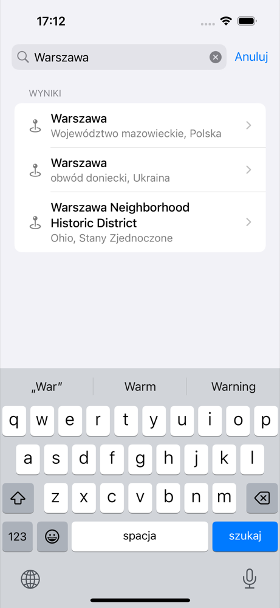
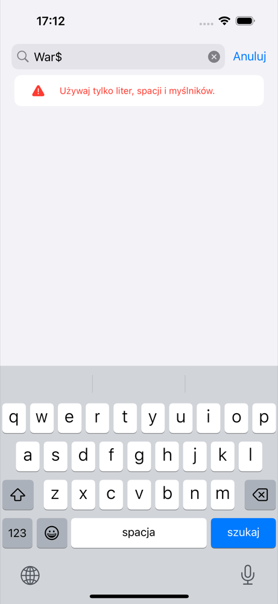
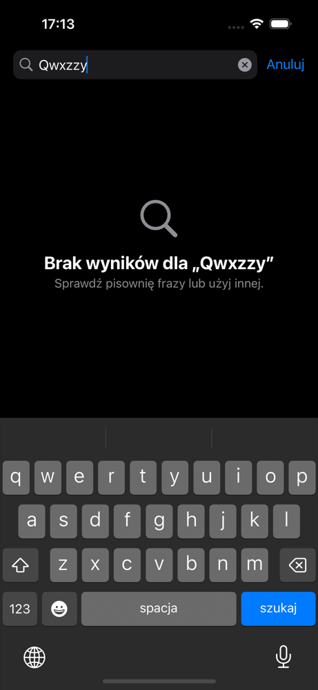
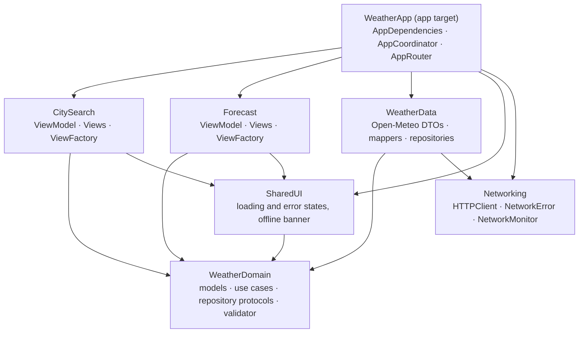

# WeatherApp

An iOS app for checking the weather forecast. Search for a city, keep your search history between
launches, and see a detailed forecast: current conditions, the next 24 hours and the next 7 days.

The project is split into SPM modules, with MVVM-C layers, unit tests and handling for every app state.
The UI is available in English and Polish; the screenshots below show the Polish version.

| Search | Forecast | Forecast (Dark Mode) | History (Dark Mode) |
|:---:|:---:|:---:|:---:|
|  |  |  |  |

| Validation | No results | Offline | Daily forecast |
|:---:|:---:|:---:|:---:|
|  |  |  |  |

## Getting started

**Requirements:** Xcode 26 or 27, iOS 17 or later.

1. Clone the repository and open `WeatherApp.xcodeproj`.
2. Select the `WeatherApp` scheme and any simulator or device running iOS 17+.
3. Run (⌘R).

The simulator needs no code signing. To run on a device, choose your own team under
*Signing & Capabilities* for the `WeatherApp` target.

The project has no third-party dependencies and no API keys. Data comes from
[Open-Meteo](https://open-meteo.com), which provides city search and forecasts without registration.

## Features

- **City search** with validation while typing:
  - accepts letters from any alphabet (including Polish characters), spaces and hyphens, e.g. "Bielsko-Biała", "Nowy Sącz";
  - rejects digits and special characters, with a separate message for each case;
  - the request is sent after a 400 ms pause in typing, and the previous request is cancelled.
- **Results list** with region and country, so cities with the same name can be told apart.
- **Search history**: the last 10 opened cities, without duplicates, newest first. Entries can be removed with a swipe. History persists across app launches.
- **Forecast details**:
  - current temperature, apparent temperature and a description of the conditions;
  - cloud cover and chance of precipitation;
  - forecast for the next 24 hours and the next 7 days;
  - pull to refresh.
- **Offline banner** visible on every screen.
- **Dark Mode, Dynamic Type and VoiceOver**: native components and semantic colors only. At large text sizes, rows switch to a vertical layout.
- **English and Polish** (String Catalogs, including correct plural forms). Search results from the API follow the app language too.
- **Units and time**: temperatures in the unit from the user's regional settings (°C or °F), hours in the selected city's time zone.

## Architecture

The app follows MVVM-C with a domain layer (use cases) and a data layer (repository + mapper).
The code is split into modules of the local SPM package `Packages/WeatherAppKit`; the app target only
composes dependencies and handles navigation.



The key rule: **features (`CitySearch`, `Forecast`) depend only on `WeatherDomain`**. They know nothing
about Open-Meteo, networking or UserDefaults. Repository implementations from `WeatherData` are injected
in one place, `AppDependencies`. Switching weather providers means a new data module; the features stay
unchanged.

### Layers and responsibilities

| Component | Responsible for | Never |
|---|---|---|
| `AppCoordinator` + `AppRouter` | navigation: turns ViewModel actions into transitions on the typed `NavigationStack` path | contains business logic |
| `ViewFactory` | building a screen: ViewModel + use cases with injected dependencies | does work on creation |
| `ContainerView` | observes the ViewModel, passes state and actions to the view | makes rendering decisions |
| `View` | renders state and calls actions through closures | holds a ViewModel reference or logic |
| `ViewModel` (`@Observable`) | all screen state as an enum, calls use cases, emits navigation actions | navigates itself or reaches a repository |
| `UseCase` | one business operation and its rules, e.g. history limit and de-duplication | calls other use cases |
| `Repository` + `Mapper` | data access, mapping DTOs to domain models | contains business logic |

Dependencies are injected through initializers and described by `Has…` protocols (e.g. `HasCityRepository`)
composed with `&`. Each type declares exactly what it needs, and a test provides only those doubles.

### Project structure

```
WeatherApp/                   app target: dependency composition and navigation
├─ App/                       entry point, AppDependencies (composition root)
├─ Navigation/                AppCoordinator, AppRouter, AppCoordinatorView
├─ Connectivity/              ConnectivityViewModel (offline banner)
└─ Resources/                 InfoPlist.xcstrings
WeatherAppTests/              coordinator and connectivity tests
WeatherAppUITests/            UI tests that don't depend on the network
Packages/WeatherAppKit/
├─ Sources/
│  ├─ Networking/             HTTPClient, Endpoint, NetworkError, NetworkMonitor
│  ├─ WeatherDomain/          Models/, UseCases/, Repositories/ (protocols), Validation/
│  ├─ WeatherData/            DTO/, Mappers/, Repositories/, OpenMeteo/
│  ├─ SharedUI/               ErrorStateView, LoadingStateView, OfflineBanner
│  ├─ CitySearch/             ViewModel, Views/, ViewFactory, Resources/ (xcstrings)
│  ├─ Forecast/               ViewModel, Views/, ViewFactory, Resources/ (xcstrings)
│  └─ NetworkingTestSupport/  URLProtocol stub shared by the tests
└─ Tests/                     tests for each module
```

## App states

| State | Search | Forecast |
|---|---|---|
| Loading | `ProgressView` "Searching…" once the debounce has passed | `ProgressView` "Loading forecast…" |
| Empty field | history, or a prompt to search | — |
| Query too short | hint "Type at least 2 letters to search." (the API returns nothing for 1 character) | — |
| Invalid characters | message above the list, no API request | — |
| No results | system `ContentUnavailableView.search` | — |
| No internet | `ContentUnavailableView` with a "Try again" button, plus the banner at the bottom of the screen | same as search |
| API error | message from the `reason` field of the Open-Meteo response, with retry | same as search |
| Failed refresh | — | the forecast stays on screen, with an error note above it |

No connection is detected from the `URLError` of the request itself (`notConnectedToInternet`,
`networkConnectionLost`, timeout, unreachable host). `NWPathMonitor` drives only the banner, because its
updates can lag behind the actual network state. Cancelled requests (e.g. while the user keeps typing)
don't show an error.

## Technical decisions and trade-offs

- **SwiftUI and `@Observable`**: native since iOS 17, no Combine. The container keeps its ViewModel in `@State`, which replaces `@StateObject` for `@Observable` types.
- **Swift 6 with strict concurrency checking**: types passed across threads are `Sendable`, ViewModels run on `@MainActor`, and errors are typed (`throws(DomainError)`).
- **SPM modules instead of folders**: the compiler enforces layer boundaries, and modules can be built and tested on their own. The cost is a bit more setup (`Package.swift`, public API).
- **A use case even where it only forwards a call** (e.g. `GetForecastUseCase`): the ViewModel–data boundary is the same everywhere, and business rules (history de-duplication and limit, minimum query length) have a clear home and tests.
- **History in UserDefaults rather than SwiftData**: it is a short list of small records. SwiftData would add a model container and `@Query` in views, which breaks the layering, for no benefit. Storage goes through a separate DTO with a versioned key (`searchHistory.v1`), so the format can change later.
- **Open-Meteo**: no API key and built-in city search. The "current" chance of precipitation is taken from the hourly data for the current hour, because the API reports it only hourly.
- **Two-step validation**: first normalization (composing decomposed Polish characters, trimming spaces and a trailing hyphen typed mid-word, e.g. "Bielsko-"), then a check of allowed characters. This way users don't see an error while typing normally.
- **Weather icons**: outline SF Symbols, because filled cloud symbols render white in multicolor mode and disappear on a light background.
- **No third-party dependencies**: networking is `URLSession` with async/await, and test doubles are written by hand.

## Tests

**63 package tests** (Swift Testing) and **4 app tests**, plus 2 UI tests:

| Module | What is tested |
|---|---|
| `Networking` | decoding, building URLs with Polish characters, mapping `URLError` and HTTP status codes |
| `WeatherDomain` | validator (Polish characters, digits, special characters, normalization), history rules, search |
| `WeatherData` | mappers on data shaped like real Open-Meteo responses, WMO weather codes, repositories via a `URLProtocol` stub, history storage |
| `CitySearch` | ViewModel state transitions, debouncing and cancelling requests, validation, history, navigation actions |
| `Forecast` | loading, retry, refresh that keeps existing data, temperature formatting (no "-0°", °F for `en_US`) |
| app | coordinator and router, connectivity banner, UI tests for launch and validation |

No test uses the real network.

**In Xcode:**
- app tests: the `WeatherApp` scheme, ⌘U;
- package tests: open `Packages/WeatherAppKit/Package.swift` and run ⌘U on the `WeatherAppKit-Package` scheme.

**From the terminal** (adjust the simulator name to one listed by `xcrun simctl list devices`):

```bash
# package tests
cd Packages/WeatherAppKit
xcodebuild test -scheme WeatherAppKit-Package -destination 'platform=iOS Simulator,name=iPhone 16'

# app tests
cd ../..
xcodebuild test -project WeatherApp.xcodeproj -scheme WeatherApp -destination 'platform=iOS Simulator,name=iPhone 16'
```

## Known limitations

- No forecast cache: offline you can browse the history, but the forecast won't load.
- Adding a city to the history reads, modifies and writes in separate steps, so two simultaneous writes could overwrite each other. In practice a write happens only when a city is selected.
- After the connection comes back, an error screen has to be retried manually.
- The `WeatherApp` scheme doesn't run the package tests; run them separately as described above.

## Ideas for further development

- Cache the latest forecast (e.g. a "network first, cache on failure" strategy) and mark stale data.
- Retry requests automatically when the connection comes back.
- Favorite cities and a forecast for the current location (Core Location).
- A test plan combining package and app tests, and CI (GitHub Actions) with build and tests.
- Snapshot tests of views in light and dark mode and at large text sizes.
- A forecast widget (WidgetKit) built on the same `WeatherDomain` and `WeatherData` modules.
